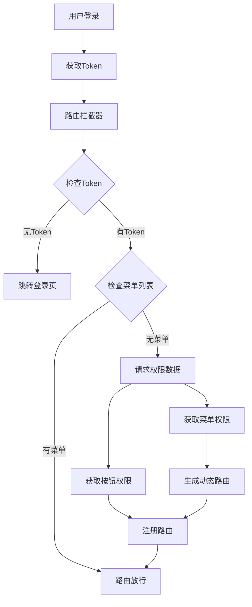
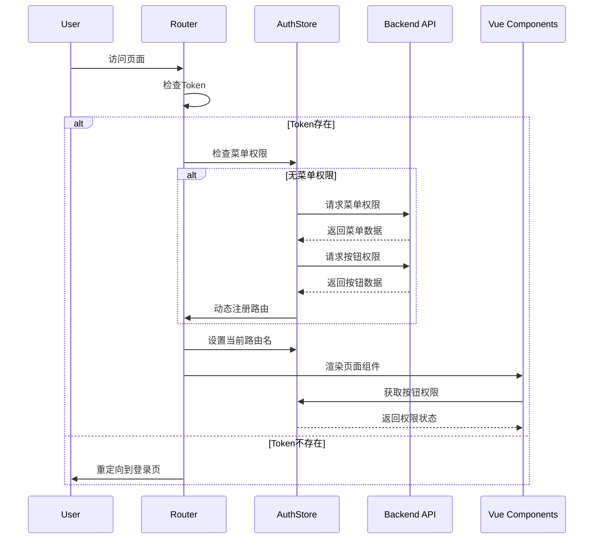

# 动态路由权限实现机制详解

## 🔐 权限系统概述

qiayun-admin 的动态路由权限系统采用了**前端路由权限控制 + 后端权限数据驱动**的设计模式，整个权限控制分为**菜单权限**和**按钮权限**两个层级。

## 🏗️ 整体架构流程



## 1. 权限数据获取 📡

### 权限接口设计

**API 接口定义**：

```typescript
// src/api/modules/login.ts

// 获取菜单列表
export const getAuthMenuListApi = () => {
  return http.get<Menu.MenuOptions[]>(PORT1 + `/menu/list`, {}, { loading: false });
  // 支持本地Mock数据
  // return authMenuList;
};

// 获取按钮权限
export const getAuthButtonListApi = () => {
  return http.get<Login.ResAuthButtons>(PORT1 + `/auth/buttons`, {}, { loading: false });
  // 支持本地Mock数据
  // return authButtonList;
};
```

### 菜单数据结构

```json
{
  "path": "/proTable",
  "name": "proTable",
  "component": "/proTable/useProTable/index",
  "meta": {
    "icon": "MessageBox",
    "title": "超级表格",
    "isHide": false,     // 是否隐藏菜单
    "isFull": false,     // 是否全屏显示
    "isAffix": false,    // 是否固定标签页
    "isKeepAlive": true, // 是否缓存页面
    "isLink": "",        // 外链地址
    "activeMenu": ""     // 高亮菜单路径
  },
  "children": [...]
}
```

### 按钮权限数据结构

```json
{
  "useProTable": ["add", "batchAdd", "export", "batchDelete", "status"],
  "authButton": ["add", "edit", "delete", "import", "export"]
}
```

## 2. 路由拦截与权限验证 🛡️

### 核心路由守卫逻辑

```typescript
// src/routers/index.ts

router.beforeEach(async (to, from, next) => {
  const userStore = useUserStore();
  const authStore = useAuthStore();

  // 1. 开始进度条
  NProgress.start();

  // 2. 动态设置页面标题
  const title = import.meta.env.VITE_GLOB_APP_TITLE;
  document.title = to.meta.title ? `${to.meta.title} - ${title}` : title;

  // 3. 访问登录页逻辑
  if (to.path.toLocaleLowerCase() === LOGIN_URL) {
    if (userStore.token) return next(from.fullPath);
    resetRouter();
    return next();
  }

  // 4. 路由白名单检查
  if (ROUTER_WHITE_LIST.includes(to.path)) return next();

  // 5. Token 验证
  if (!userStore.token) return next({ path: LOGIN_URL, replace: true });

  // 6. 动态路由初始化
  if (!authStore.authMenuListGet.length) {
    await initDynamicRouter();
    return next({ ...to, replace: true });
  }

  // 7. 存储当前路由名称用于按钮权限筛选
  authStore.setRouteName(to.name as string);

  // 8. 放行访问
  next();
});
```

### 路由守卫关键点解析

1. **Token检查**：优先验证用户登录状态
2. **白名单机制**：错误页面等基础路由无需权限验证
3. **动态路由懒加载**：仅在需要时初始化权限路由
4. **路由名称存储**：为按钮权限提供当前页面上下文

## 3. 动态路由生成 ⚙️

### 动态路由初始化过程

```typescript
// src/routers/modules/dynamicRouter.ts

export const initDynamicRouter = async () => {
  const userStore = useUserStore();
  const authStore = useAuthStore();

  try {
    // 1. 获取权限数据
    await authStore.getAuthMenuList();
    await authStore.getAuthButtonList();

    // 2. 权限验证
    if (!authStore.authMenuListGet.length) {
      ElNotification({
        title: "无权限访问",
        message: "当前账号无任何菜单权限，请联系系统管理员！",
        type: "warning",
        duration: 3000
      });
      userStore.setToken("");
      router.replace(LOGIN_URL);
      return Promise.reject("No permission");
    }

    // 3. 动态添加路由
    authStore.flatMenuListGet.forEach(item => {
      item.children && delete item.children;

      // 组件路径转换
      if (item.component && typeof item.component == "string") {
        item.component = modules["/src/views" + item.component + ".vue"];
      }

      // 根据 isFull 决定路由嵌套
      if (item.meta.isFull) {
        router.addRoute(item as unknown as RouteRecordRaw);
      } else {
        router.addRoute("layout", item as unknown as RouteRecordRaw);
      }
    });
  } catch (error) {
    // 错误处理
    userStore.setToken("");
    router.replace(LOGIN_URL);
    return Promise.reject(error);
  }
};
```

### 关键技术实现

#### 1. 组件动态导入

```typescript
// 批量导入views文件夹下所有vue组件
const modules = import.meta.glob("@/views/**/*.vue");

// 动态设置组件
item.component = modules["/src/views" + item.component + ".vue"];
```

#### 2. 路由扁平化处理

```typescript
// src/utils/index.ts
export function getFlatMenuList(menuList: Menu.MenuOptions[]): Menu.MenuOptions[] {
  let newMenuList: Menu.MenuOptions[] = JSON.parse(JSON.stringify(menuList));
  return newMenuList.flatMap(item => [item, ...(item.children ? getFlatMenuList(item.children) : [])]);
}
```

#### 3. 菜单显示过滤

```typescript
// 过滤需要显示的菜单（剔除 isHide = true 的项）
export function getShowMenuList(menuList: Menu.MenuOptions[]) {
  let newMenuList: Menu.MenuOptions[] = JSON.parse(JSON.stringify(menuList));
  return newMenuList.filter(item => {
    item.children?.length && (item.children = getShowMenuList(item.children));
    return !item.meta?.isHide;
  });
}
```

## 4. 权限状态管理 📦

### Pinia Store 权限模块

```typescript
// src/stores/modules/auth.ts

export const useAuthStore = defineStore({
  id: "geeker-auth",
  state: (): AuthState => ({
    authButtonList: {}, // 按钮权限列表
    authMenuList: [], // 菜单权限列表
    routeName: "" // 当前路由名称
  }),

  getters: {
    // 原始菜单权限列表
    authMenuListGet: state => state.authMenuList,

    // 显示菜单列表（过滤隐藏项）
    showMenuListGet: state => getShowMenuList(state.authMenuList),

    // 扁平化菜单列表（用于路由注册）
    flatMenuListGet: state => getFlatMenuList(state.authMenuList),

    // 面包屑导航列表
    breadcrumbListGet: state => getAllBreadcrumbList(state.authMenuList),

    // 按钮权限列表
    authButtonListGet: state => state.authButtonList
  },

  actions: {
    // 获取菜单权限
    async getAuthMenuList() {
      const { data } = await getAuthMenuListApi();
      this.authMenuList = data;
    },

    // 获取按钮权限
    async getAuthButtonList() {
      const { data } = await getAuthButtonListApi();
      this.authButtonList = data;
    },

    // 设置当前路由名称
    async setRouteName(name: string) {
      this.routeName = name;
    }
  }
});
```

## 5. 按钮级权限控制 🔘

### 权限指令实现

```typescript
// src/directives/modules/auth.ts

const auth: Directive = {
  mounted(el: HTMLElement, binding: DirectiveBinding) {
    const { value } = binding;
    const authStore = useAuthStore();
    const currentPageRoles = authStore.authButtonListGet[authStore.routeName] ?? [];

    if (value instanceof Array && value.length) {
      // 数组权限：需要全部包含
      const hasPermission = value.every(item => currentPageRoles.includes(item));
      if (!hasPermission) el.remove();
    } else {
      // 单个权限
      if (!currentPageRoles.includes(value)) el.remove();
    }
  }
};
```

### 权限 Hooks 封装

```typescript
// src/hooks/useAuthButtons.ts

export const useAuthButtons = () => {
  const route = useRoute();
  const authStore = useAuthStore();
  const authButtons = authStore.authButtonListGet[route.name as string] || [];

  const BUTTONS = computed(() => {
    let currentPageAuthButton: { [key: string]: boolean } = {};
    authButtons.forEach(item => (currentPageAuthButton[item] = true));
    return currentPageAuthButton;
  });

  return { BUTTONS };
};
```

### 三种权限控制使用方式

#### 1. 指令方式

```vue
<template>
  <!-- 单个权限 -->
  <el-button v-auth="'add'">添加</el-button>

  <!-- 多个权限（AND关系） -->
  <el-button v-auth="['edit', 'delete']">批量操作</el-button>
</template>
```

#### 2. Hooks方式

```vue
<script setup>
const { BUTTONS } = useAuthButtons();
</script>

<template>
  <el-button v-if="BUTTONS.add">添加</el-button>
  <el-button v-if="BUTTONS.edit">编辑</el-button>
</template>
```

#### 3. Store直接访问

```vue
<script setup>
const authStore = useAuthStore();
const hasAddPermission = computed(() => authStore.authButtonListGet[route.name]?.includes("add"));
</script>

<template>
  <el-button v-if="hasAddPermission">添加</el-button>
</template>
```

## 6. 路由重置机制 🔄

```typescript
// src/routers/index.ts

export const resetRouter = () => {
  const authStore = useAuthStore();
  // 移除所有动态添加的路由
  authStore.flatMenuListGet.forEach(route => {
    const { name } = route;
    if (name && router.hasRoute(name)) router.removeRoute(name);
  });
};
```

## 7. 静态路由配置 🏠

```typescript
// src/routers/modules/staticRouter.ts

export const staticRouter: RouteRecordRaw[] = [
  {
    path: "/",
    redirect: HOME_URL
  },
  {
    path: LOGIN_URL,
    name: "login",
    component: () => import("@/views/login/index.vue"),
    meta: { title: "登录" }
  },
  {
    path: "/layout",
    name: "layout",
    component: () => import("@/layouts/index.vue"),
    redirect: HOME_URL,
    children: [] // 动态路由将作为children添加到此处
  }
];
```

## 8. 权限系统特点总结 ✨

### 🎯 设计优势

1. **分层权限控制**：菜单级 + 按钮级权限
2. **动态路由生成**：根据权限数据动态添加路由
3. **多种控制方式**：指令、Hooks、直接判断
4. **完整的生命周期**：登录 → 获取权限 → 生成路由 → 权限验证 → 路由清理

### 🛡️ 安全机制

1. **Token失效处理**：自动清理路由并跳转登录
2. **权限失效保护**：无权限时显示提示并清理状态
3. **路由白名单**：错误页面等基础路由无需权限验证
4. **请求拦截**：API请求自动携带Token

### 🔧 扩展性设计

1. **模块化权限数据**：支持本地Mock和远程API
2. **灵活的菜单配置**：支持隐藏、全屏、缓存等多种属性
3. **组件懒加载**：动态导入减少初始包体积
4. **状态持久化**：权限数据可持久存储

### 📊 权限流程时序图



这个权限系统设计完整、功能强大，很好地平衡了安全性、灵活性和用户体验，是一个可以直接用于生产环境的成熟方案。
